<p align="center">
  <picture>
    <source media="(max-width: 600px) and (prefers-color-scheme: light)" srcset=".github/assets/banner-phone-light.svg">
    <source media="(max-width: 600px)" srcset=".github/assets/banner-phone.svg">
    <source media="(prefers-color-scheme: light)" srcset=".github/assets/banner-light.svg">
    
  </picture>
</p>

<div align="center">

[](https://github.com/EquityBot/Puritanical/actions/workflows/test.yml) [](https://github.com/EquityBot/Puritanical/actions/workflows/codeql.yml) [](https://sonarcloud.io/summary/new_code?id=EquityBot_Puritanical)<br>
[](LICENSE) [](https://github.com/DietrichGebert/ponytail)

[Install](#install) · [Use](#use) · [The rules](#the-rules) · [How it compares](#how-it-compares) · [Changes from Ponytail](#changes-from-ponytail) · [Development](#development)

</div>

Puritanical is a skill and plugin for coding agents. Many Puritans sought to strip from worship whatever scripture did not warrant; Puritanical strips from each change whatever the request does not require. Correctness, safety, accessibility and verification are never stripped. It has adapters for 34 agent hosts, including Claude Code, Codex, Copilot CLI, Cursor, OpenCode and Gemini CLI.

**Input:** with Puritanical active, ask the agent to fix a bug where `transfer()` overdraws an account through a shared `_debit()` helper.

**Expected behaviour:** the agent reads `_debit()` and its other callers, fixes the check in `_debit()` rather than guarding only `transfer()`, adds a test that fails without the fix, runs the suite, and reports which checks ran.

**Your decision:** review the diff. Puritanical guides the agent; it does not prove the change correct.

## Install

Claude Code, as 2 separate prompts:

```text
/plugin marketplace add EquityBot/Puritanical
```

```text
/plugin install puritanical@puritanical
```

Codex:

```bash
codex plugin marketplace add EquityBot/Puritanical
codex plugin add puritanical@puritanical
```

Then open `/hooks` in Codex, trust its 2 lifecycle hooks and start a new thread.

For any other agent, copy [`AGENTS.md`](AGENTS.md) into your project, or follow [INSTALL.md](INSTALL.md) for your host. The Claude Code, Codex and Cursor integrations run small Node.js hooks, so `node` must be on your PATH.

Install only from `EquityBot/Puritanical` on GitHub. This repository ships no executables; the Rust code in `tools/` is maintainer tooling that you build yourself.

## Use

Puritanical is on for every session at the `full` level. Change the level for the session with a command:

| Command | What it does |
| --- | --- |
| `/puritanical [lite \| full \| ultra \| off]` | Sets the level, or turns it off. With no argument it switches on at the default level, or reports the current level. |
| `/puritanical default <level>` | Sets the level new sessions start at. |
| `/puritanical-review` | Reviews the current diff for bugs, security, behaviour under load, untested risky code, slow paths and code to delete. Name a target such as `staged`, `branch` or a PR link. |
| `/puritanical-audit` | Runs the same review over the whole repository, most important first. |
| `/puritanical-debt` | Lists every `shortcut:` comment, and older `ponytail:` ones, as a debt ledger. |
| `/puritanical-help` | Shows these commands and levels. |

The review, audit, debt and help skills run only when you call them. In Codex, call them as `$puritanical:puritanical-review`. Rule-file hosts such as Windsurf, Cline and Kiro load the rules without commands. To set the default without a command, use `PURITANICAL_DEFAULT_MODE` or `defaultMode` in `~/.config/puritanical/config.json`.

## The rules

The whole ruleset is [`skills/puritanical/SKILL.md`](skills/puritanical/SKILL.md). Before writing code the agent reads the affected code and its callers, then takes the first option that meets the complete requirements:

1. Leave out what is not required now.
2. Reuse what the codebase already has.
3. Use the standard library.
4. Use a native platform feature.
5. Use an installed dependency.
6. Write a direct expression.
7. Write the smallest cohesive implementation.

The ladder never removes input validation at trust boundaries, security, accessibility, error handling that prevents data loss or required hardware calibration. A deliberate corner cut gets a `shortcut:` comment naming its limit and when to revisit it.

## How it compares

| Project | What it is | Choose it when you want | Licence |
| --- | --- | --- | --- |
| **Puritanical** | Rules and a plugin for the smallest correct change: read the callers, test that the test fails without the fix, report what ran | Smaller changes with the checks and the honest report kept, and no persona or status board | FSL-1.1-ALv2, not OSI open source; each version becomes Apache-2.0 after 2 years |
| [Ponytail](https://github.com/DietrichGebert/ponytail) | The ladder this project forked, in a lazy senior developer persona, with a status board and published benchmarks | A large community, upstream measurements or an MIT licence | MIT |
| [Karpathy guidelines](https://github.com/multica-ai/andrej-karpathy-skills) | One `CLAUDE.md` with 4 principles | Something you can read in a minute and paste into a project | MIT |
| [Superpowers](https://github.com/obra/superpowers) | A skills framework and development methodology | A whole development process, not only rules for each change | MIT |

Puritanical has not yet been measured against these projects; [Benchmarks](#benchmarks) says how to run the comparison.

## Changes from Ponytail

Puritanical is a fork of [Ponytail](https://github.com/DietrichGebert/ponytail) by Dietrich Gebert, taken at upstream `main` after v5.3.2 (commit `09c434a`).

The ruleset:

- puts correctness, safety, accessibility, maintainability and required performance ahead of fewer lines, files or tokens;
- states its chosen reading of an ambiguous request, or asks when the choice is costly to reverse;
- checks that an API, flag or symbol exists in the installed version before relying on it;
- stops patching after 2 failed fix attempts and rechecks the evidence and design;
- requires a regression test that fails without the fix, with no one-test ceiling;
- rejects malformed input in data, money and security paths, or reports what was skipped;
- keeps every changed line traceable to the request and reports other dead code instead of deleting it;
- claims only checked results, names each check and marks the rest as not run;
- drops the lazy-developer persona and the per-reply 'skipped' footer.

The plugin:

- does not inject the ruleset into Claude Code or Codex subagents, or again into a resumed session that already has it;
- removes the Band status board, which wrapped every Bash, Edit and Write call and logged prompt text to a local file;
- removes the gain scoreboard, which reported upstream benchmark figures;
- makes the session-start codebase map opt-in with `PURITANICAL_MAP=1`;
- refuses to follow a planted symlink when writing mode and config files on macOS and Linux;
- fixes subagent injection and host detection in Qoder, CommonJS exports in the codebase map and rule loading in Pi when another extension forces the system prompt;
- generates `AGENTS.md`, 7 host rule files, the command prompts, the OpenClaw skills and both fallback strings from `skills/`, with a Rust tool that CI runs to catch drift.

The 4 fixes came from community forks: [duofuwang](https://github.com/duofuwang/ponytail), [vincntlaw](https://github.com/vincntlaw/ponytail), [leiyangyou](https://github.com/leiyangyou/ponytail) and [Eugene3dotdev](https://github.com/Eugene3dotdev/ponytail). Issue numbers in code comments and the host verification notes in [docs/](docs/) refer to upstream Ponytail.

## Benchmarks

Puritanical has not been benchmarked yet. The harness in [benchmarks/](benchmarks/) comes from upstream; its published results measure the upstream rulesets. [Head to head](benchmarks/agentic/README.md#head-to-head) runs Puritanical, Ponytail, Superpowers, the Karpathy guidelines and no skill in one run from pinned checkouts, and [`behavior.yaml`](benchmarks/behavior.yaml) probes whether the rules this fork added change what the agent does.

## Development

```bash
npm test
cargo run --manifest-path tools/Cargo.toml -- sync --check
cargo run --manifest-path tools/Cargo.toml -- check-versions
```

Edit `skills/*/SKILL.md`, then run `cargo run --manifest-path tools/Cargo.toml -- sync` to regenerate the copies. [CONTRIBUTING.md](.github/CONTRIBUTING.md) covers the checks and the evidence a ruleset change needs.

## Licence

Licensed under the Functional Source License, Version 1.1, ALv2 Future License (FSL-1.1-ALv2). You may use, modify and redistribute it for any purpose except a Competing Use as defined in LICENSE (making it available to others in a competing commercial product or service), and each version becomes available under Apache-2.0 two years after it is made available. See [LICENSE](LICENSE) and [NOTICE](NOTICE). Portions derived from Dietrich Gebert's Ponytail remain under the MIT License, whose notice is kept in [NOTICE](NOTICE).

The banner's lettering and emblem are drawn from Cascadia Mono glyphs (SIL OFL 1.1).

Neither licence covers the scripture quotation in the footer. Scripture quoted by permission. Quotations designated (NET) are from the NET Bible® copyright ©1996, 2019 by Biblical Studies Press, L.L.C. [netbible.com](http://netbible.com) All rights reserved.

---

<p align="center"><sub><i>'Do not add a thing to what I command you nor subtract from it.'</i> Deuteronomy 4:2 (<a href="https://netbible.org/">NET</a>)<br>Made by <a href="https://github.com/EquityBot">EquityBot</a>. <i>Ad gloriam eius, non meam.</i></sub></p>
